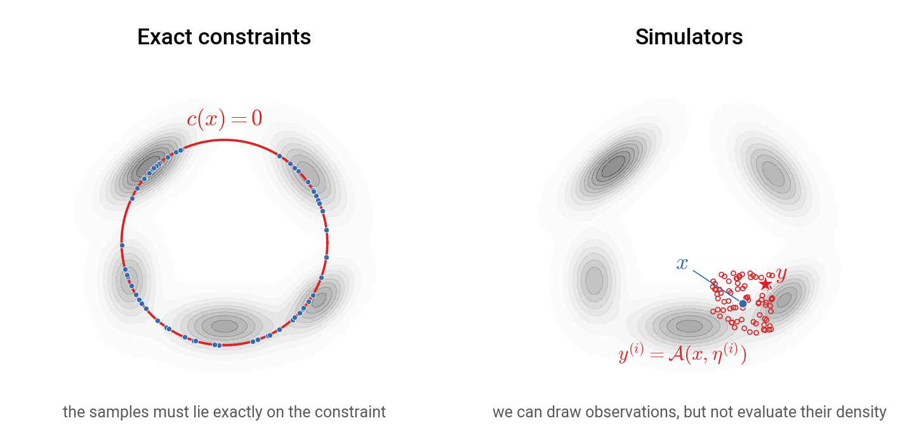
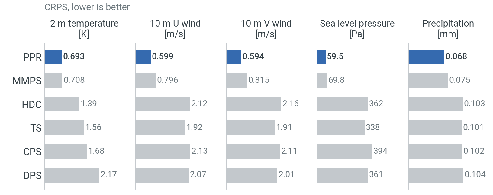
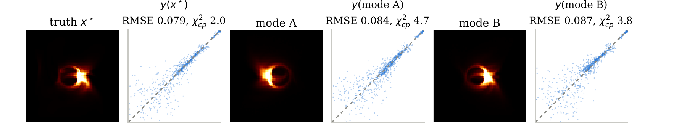

class: black-slide
background-image: url(figures/title-bg.gif)
background-size: cover

.overlay-box.overlay-title-slide[
.overlay-title[Harness, don't retrain .smaller[Diffusion models as steerable priors for inverse problems]]

.title-author[.title-author-text[Gilles Louppe .smaller[[g.louppe@uliege.be](mailto:g.louppe@uliege.be)]]]

.title-footer[.smaller[Flatiron Institute, New York October 28, 2026]]
]

???

Thank you for having me.

One idea: a trained diffusion model can be steered while it samples, without retraining. We will follow one problem, the atmosphere, to the end.

---

class: middle, black-slide, center
background-image: url(figures/title-bg.gif)
background-size: cover

.bold.larger.shadowed[From a noisy observation $y$...]

???

Suppose we observe this. It is a coarse and noisy view of a 2D turbulent flow. Each block is an average.

---

class: middle, black-slide, center

.bg-video[<video autoplay muted loop playsinline poster="figures/x.png" src="figures/videos/teaser-x.mp4"></video>]

.bold.larger.shadowed[... can we recover   all plausible physical states $x$?]

???

We want all the flows that could have produced it, as a distribution.

The same question comes up whenever an instrument stands between us and what we study. Three examples.

---

class: black-slide
background-image: url(figures/mic-y.png)
background-size: cover

.overlay-box.overlay-intro[
.overlay-title[Cryo-electron microscopy]

Thousands of noisy 2D projections $y$ of a molecule, in unknown orientations.
]

.footnote[Simulated particle images of the .italic[P. falciparum] 80S ribosome (EMD-2660).]

???

First, cryo-electron microscopy. We get thousands of 2D images of a molecule. Each one is seen from an unknown angle, and is very noisy. This is $y$.

---

class: black-slide
background-image: url(figures/mic-x.png)
background-size: cover

.overlay-box.overlay-intro[
.overlay-title[Cryo-electron microscopy]

The 3D structure $x$ of the molecule.
]

.footnote[Structure: EMD-2660, [Wong et al](https://doi.org/10.7554/eLife.03080), eLife 2014. Reconstructed with a generative prior by CryoFM: [Zhou et al](https://arxiv.org/abs/2410.08631), ICLR 2025 (arXiv:2410.08631).]

???

We want the molecule itself, in 3D. This is $x$.

---

class: black-slide
background-image: url(figures/mri-y.png)
background-size: cover

.overlay-box.overlay-top-right[
.overlay-title[Accelerated MRI]

Undersampling k-space speeds up the scan but leaves aliased images $y$.
]

.footnote[Credits: [Rozet et al](https://arxiv.org/abs/2405.13712), NeurIPS 2024 (arXiv:2405.13712).]

???

Second, MRI. A scanner measures the Fourier transform of the image, line by line, in what is called k-space. To scan faster, we measure only some of the lines: here, one in six on average. Filling the rest with zeros gives this blurry, aliased image. This is $y$.

---

class: black-slide
background-image: url(figures/mri-x.png)
background-size: cover

.overlay-box.overlay-top-right[
.overlay-title[Accelerated MRI]

The full-resolution scans $x$.
]

.footnote[Credits: [Rozet et al](https://arxiv.org/abs/2405.13712), NeurIPS 2024 (arXiv:2405.13712).]

???

We want the full scan. This is $x$. The missing data must be filled in, in a way that looks like a knee.

---

class: black-slide
background-image: url(figures/bh-y.png)
background-size: cover

.overlay-box.overlay-top-left[
.overlay-title[Black hole imaging]

A few radio telescopes across the Earth sample the Fourier transform $y$ of the image.
]

.footnote[Data: [EHT Collaboration](https://github.com/eventhorizontelescope/2019-D01-01), M87*, April 11, 2017.]

???

Third, black holes. Each pair of radio telescopes measures one Fourier coefficient of the image: how much it contains of a stripe pattern, of one orientation and spacing. The farther apart the telescopes, the finer the stripes. As the Earth rotates, each pair traces a track. Most of the plane stays empty. This is $y$.

---

class: black-slide
background-image: url(figures/bh-x.png)
background-size: cover

.overlay-box.overlay-top-left[
.overlay-title[Black hole imaging]

Images $x$ of M87*, all consistent with the data.
]

.footnote[Credits: [Wu et al](https://arxiv.org/abs/2405.18782), NeurIPS 2024 (arXiv:2405.18782).]

???

We want the image. Many images fit the same data. The ring is always there. The details change.

---

class: middle

.center.width-80[]

## Inverse problems in science

Given noisy observations $y$, estimate the posterior distribution $$p(x|y) = \frac{p(y|x) p(x)}{p(y)}$$ of latent states $x$.

???

All these examples are the same problem. A physical process produces $x$, an instrument turns it into $y$.

We want to go back, as a distribution: the posterior. It combines a prior, for the physics, and a likelihood, for the instrument.

---

class: middle

.grid[
.kol-1-4[&nbsp;]
.kol-3-4[.flow.flow-right[Generation]]
]

.grid[
.kol-1-4[&nbsp;]
.kol-3-8[.center[.icons[] .bold[Prior] $p(x)$]]
.kol-3-8[.center[.icons[] .bold[Likelihood] $p(y | x)$]]
]

.recipe[
.grid[
.kol-1-4[.italic[Cryo-EM]]
.kol-3-8[.center[3D structures of molecules]]
.kol-3-8[.center[projection, microscope blur, noise]]
]

.grid[
.kol-1-4[.italic[MRI]]
.kol-3-8[.center[full-resolution scans]]
.kol-3-8[.center[undersampled Fourier, noise]]
]
.grid[
.kol-1-4[.italic[Black hole imaging]]
.kol-3-8[.center[images of black holes]]
.kol-3-8[.center[sparse Fourier sampling, noise]]
]
]

.grid[
.kol-1-4[&nbsp;]
.kol-3-4[.flow.flow-left[Inference]]
]

???

The likelihood is the instrument. We know it well, and it changes often.

The prior is the hard part. It does not change. So we want to learn it once, and reuse it.

---

class: middle

## Diffusion models 101

A forward diffusion process gradually turns samples $x \sim p(x)$ into noise,
$$\text{d} x\_t = f\_t x\_t \text{d}t + g\_t \text{d}w\_t.$$
As in EDM,
$$f\_t = 0, \quad g\_t = \sqrt{\text{d}\sigma\_t^2 / \text{d}t}, \quad \text{so that} \quad p(x\_t | x) = \mathcal{N}(x, \Sigma\_t), \quad \Sigma\_t = \sigma\_t^2 I.$$

.center[
.width-80[] 
.italic[Forward diffusion process.]
]

.footnote[Adapted from [Song](https://yang-song.net/blog/2021/score/), 2021. EDM: [Karras et al](https://arxiv.org/abs/2206.00364), NeurIPS 2022. Variance-preserving processes reduce to it by rescaling.]

???

We use diffusion models. First, we add noise to the data, until only noise remains. As in EDM, noise is simply added: $x_t = x + \epsilon$. Other conventions reduce to it by rescaling.

---

class: middle

The reverse process is also a diffusion, driven by the .bold[score] $\nabla\_{x\_t} \log p(x\_t)$,
$$\text{d}x\_t = \left[ f\_t x\_t - g\_t^2 \nabla\_{x\_t} \log p(x\_t) \right] \text{d}t + g\_t \text{d}w\_t.$$
Simulating it from noise $x\_1$ to $t = 0$ generates samples $x\_0 \sim p(x)$.

.center[
.width-90[] 
.italic[Reverse denoising process.]
]

.footnote[Adapted from [Song](https://yang-song.net/blog/2021/score/), 2021.]

???

Second, we run this backward, from noise to a new sample. For this, we need the score.

---

class: middle

.center.width-90[]

The score is unknown, but can be approximated via a neural denoiser $d\_\theta(x\_t, t)$ trained to recover $x$ from $x\_t$,
$$\min\_\theta \\, \mathbb{E}\_{p(t)p(x)p(x\_t|x)} \left[ || d\_\theta(x\_t, t) - x ||^2\_2 \right].$$
The optimal denoiser is $\mathbb{E}[x | x\_t]$, which gives the score by Tweedie's formula,
$$\nabla\_{x\_t} \log p(x\_t) = \Sigma\_t^{-1}(\mathbb{E}[x | x\_t] - x\_t) \approx \Sigma\_t^{-1}(d\_\theta(x\_t, t) - x\_t) = s\_\theta(x\_t, t).$$

In practice, the denoiser is preconditioned as in EDM, $d_\theta(x_t, t) = c_\text{skip}\, x_t + c_\text{out}\, F_\theta(c_\text{in}\, x_t, c_\text{noise})$, with $F_\theta$ the network and coefficients that depend on $\sigma_t$.

???

We train a network to denoise. By Tweedie's formula, its guess gives the score.

---

class: middle

With the learned score, the reverse SDE from $t$ down to $s$ is
$$x\_s = x\_t + \int\_s^t g\_u^2\, s\_\theta(x\_u, u) \text{d}u + \int\_s^t g\_u \text{d}w\_u.$$
Euler–Maruyama freezes the score at $x\_t$, and $\int\_s^t g\_u^2 \text{d}u = \Sigma\_t - \Sigma\_s$,
$$x\_s \approx x\_t + (\Sigma\_t - \Sigma\_s)\, s\_\theta(x\_t, t) + (\Sigma\_t - \Sigma\_s)^{1/2} z.$$
Ancestral sampling matches it in expectation, through $\hat{x}$,
$$\begin{aligned} &\text{denoise} && \hat{x} = x\_t + \Sigma\_t\, s\_\theta(x\_t, t) = d\_\theta(x\_t, t), \\\\ &\text{renoise} && x\_s \sim p(x\_s \mid x\_t, x = \hat{x}) = \mathcal{N}\big(\hat{x} + \Sigma\_s \Sigma\_t^{-1} (x\_t - \hat{x}),\ \Sigma\_s - \Sigma\_s \Sigma\_t^{-1} \Sigma\_s\big). \end{aligned}$$

.center.width-90[]

???

We cannot integrate the reverse equation exactly, so we take small steps.

Euler–Maruyama moves straight along the score, then adds noise.

Ancestral sampling first denoises to $\hat{x}$, then renoises back part of the way. On average, it lands at the same place.

We use ancestral sampling, because $\hat{x}$ is where we will intervene.

---

class: middle

.center[
<video poster="figures/steer/prior_poster.jpg?v=1027a" muted loop autoplay playsinline class="anim">
<source src="figures/steer/prior.mp4?v=1027a" type="video/mp4">
</video>
]

???

This is the step of the previous slide, now repeated in a loop, from the highest noise level down to zero. Here on a 2D toy, a mixture of five Gaussians. Denoise, renoise, repeat. The particles end as samples of the prior.

The network is trained once. The loop is ours.

---

class: middle

## Posterior sampling: retrain...

.center.width-90[]

To sample from the posterior $p(x|\textcolor{#d62728}{y})$, one can .bold[hard-wire] the observation $\textcolor{#d62728}{y}$ as an additional input of the denoiser $d\_\theta(x\_t, t, \textcolor{#d62728}{y})$ and train it on pairs $(x, \textcolor{#d62728}{y})$.

.alert[Every new instrument requires training a new network.]

???

One option: give $y$ to the denoiser and retrain. Each new instrument needs a new network.

---

class: middle

.center.width-10[]

## ... or harness.

Instead, we keep the pretrained model and .bold[harness] its sampling. Since
$$\nabla\_{x\_t} \log p(x\_t | \textcolor{#d62728}{y}) = \nabla\_{x\_t} \log p(x\_t) + \nabla\_{x\_t} \log p(\textcolor{#d62728}{y} | x\_t),$$
we add the likelihood score to the prior score in the denoising step,
$$\hat{x} = x\_t + \Sigma\_t \big( \underbrace{s\_\theta(x\_t, t)}\_{\text{pretrained prior}} + \textcolor{#d62728}{\underbrace{\nabla\_{x\_t} \log p(y | x\_t)}\_{\text{likelihood}}} \big),$$
and renoise as before. The loop then produces posterior samples $x \sim p(x | \textcolor{#d62728}{y})$, without retraining the network.

The likelihood of a noisy state, $p(y | x_t) = \int p(y | x) p(x | x_t) \text{d}x$, is intractable.

???

The other option: keep the prior, and add the likelihood score in the denoising step. Only the red term changes with the instrument.

But this likelihood score is intractable.

---

class: middle

.avatars[]

## Moment Matching Posterior Sampling

MMPS approximates $p(x | x\_t)$ by a Gaussian, with Tweedie's covariance,
$$p(x | x\_t) \approx \mathcal{N}(x \mid \mathbb{E}, \mathbb{V}), \quad \mathbb{E} = \mathbb{E}[x | x\_t], \quad \mathbb{V} = \mathbb{V}[x | x\_t] = \Sigma\_t \nabla\_{x\_t} \mathbb{E}.$$
For $p(y | x) = \mathcal{N}(y | Ax, \Sigma\_y)$, the integral becomes Gaussian, with the uncertainty of the denoiser added to the noise of the observation,
$$p(y | x\_t) \approx \mathcal{N}\big(y \mid A \mathbb{E}, \Sigma\_y + A \mathbb{V} A^\top\big),$$
and the denoising step of the harnessed sampler becomes a Kalman update,
$$\begin{aligned} \hat{x} &= x\_t + \Sigma\_t \big( s\_\theta(x\_t, t) + \textcolor{#d62728}{\nabla\_{x\_t} \log p(y | x\_t)} \big) \\\\ &\approx d\_\theta + \mathbb{V}\_\theta A^\top \big(\Sigma\_y + A \mathbb{V}\_\theta A^\top\big)^{-1} \big(y - A d\_\theta\big), \end{aligned}$$
with the denoiser $d\_\theta = d\_\theta(x\_t, t)$ in place of $\mathbb{E}$, and $\mathbb{V}\_\theta = \Sigma\_t \nabla\_{x\_t} d\_\theta$ in place of $\mathbb{V}$.

.footnote[Credits: [Rozet et al](https://arxiv.org/abs/2405.13712), NeurIPS 2024 (arXiv:2405.13712).]

???

It averages over all the clean states behind the noisy one.

MMPS approximates them by a Gaussian, with the denoiser's guess and its uncertainty. For a linear Gaussian instrument, the denoising step becomes a Kalman update: move towards $y$, a lot where the denoiser is unsure, little where it is confident.

DPS ignores this uncertainty, and overshoots.

---

class: middle

.avatars[]

.center[
<video poster="figures/steer/mmps_poster.jpg?v=1027a" muted loop autoplay playsinline class="anim">
<source src="figures/steer/mmps.mp4?v=1027a" type="video/mp4">
</video>
]

.center[MMPS, given a noisy observation $y = x + \eta$ of the state.]

.footnote[Credits: [Rozet et al](https://arxiv.org/abs/2405.13712), NeurIPS 2024 (arXiv:2405.13712).]

???

MMPS on the toy. The red star is $y$; the dashed lines, the exact posterior.

Each step: denoise, correct towards $y$ in orange, renoise.

Most samples end close to the posterior. A few end on other modes: the price of the Gaussian assumption.

---

class: black-slide
background-image: url(figures/satellite-crop.gif)
background-size: cover

.overlay-box.overlay-bottom-left[
.overlay-title[Earth observation]

Satellites measure radiances $y$, not the state of the atmosphere.
]

.footnote[Animation: [ESA/ATG medialab](https://www.esa.int/ESA_Multimedia), Sentinel-1.]

???

Now the atmosphere. Millions of sparse, noisy, indirect observations every day. Satellites measure radiances, not the state. Keep this in mind.

---

class: black-slide
background-image: url(figures/da-x.png)
background-size: cover

.overlay-box.overlay-bottom-right[
.overlay-title[Earth observation]

The state $x$ of the atmosphere, here the wind speed at 10 m.
]

.footnote[Data: [ERA5](https://doi.org/10.1002/qj.3803) reanalysis, 10 m wind speed, March 21, 2021.]

???

We want the full state over time: data assimilation. It gives reanalyses, and the start of every forecast.

---

class: middle

## Data assimilation

We estimate trajectories $x\_{1:L}$ given observations $y\_{1:L}$, as the posterior
$$p(x\_{1:L} | y\_{1:L}) \propto p(x\_1) p(y\_1 | x\_1) \prod\_{i=2}^{L} p(x\_{i} | x\_{i-1}) p(y\_{i} | x\_{i}).$$

.center.width-100[]

???

We want the posterior over whole trajectories, with a diffusion prior.

Three obstacles: trajectories are long, they are huge, and instruments are not always simple.

---

class: middle

.avatars[]

.center.width-80[]

SDA trains on short windows only. For Markovian dynamics,
$$\nabla\_{x\_i(t)} \log p(x\_{1:L}(t)) \approx \nabla\_{x\_i(t)} \log p(x\_{i-k:i+k}(t)),$$
with equality at $t = 0$ only. A fully convolutional denoiser, with receptive field $x\_{i-k:i+k}$, gives the score of the whole trajectory. Then, posterior sampling adds the likelihood score of the observations,
$$\nabla \log p(x\_{1:L}(t) | y\_{1:L}) = \nabla \log p(x\_{1:L}(t)) + \textcolor{#d62728}{\nabla \log p(y\_{1:L} | x\_{1:L}(t))}.$$

.footnote[Credits: [Rozet and Louppe](https://arxiv.org/abs/2306.10574), NeurIPS 2023 (arXiv:2306.10574).]

???

First, length. SDA trains on short windows only. A fully convolutional denoiser gives the score of the whole trajectory. Then we add the likelihood score, as before.

The window decomposition is exact for clean trajectories only. With noise, distant states become coupled, and the approximation gets worse. Keep this in mind for later.

---

class: middle

.avatars[]

.center.width-100[]

.center[Ground truth $x\_{1:L}$ and coarse, noisy, sparse observations $y$.]

.footnote[Credits: [Rozet and Louppe](https://arxiv.org/abs/2306.10574), NeurIPS 2023 (arXiv:2306.10574).]

???

The 2D flow. Top, the truth. Below, coarse observations, every few steps.

---

class: middle
count: false

.avatars[]

.center.width-100[]

.center[Posterior samples of the trajectory, given $y$.]

.footnote[Credits: [Rozet and Louppe](https://arxiv.org/abs/2306.10574), NeurIPS 2023 (arXiv:2306.10574).]

???

Posterior samples. They agree with the data, and differ where the data leave room.

---

class: middle

.avatars[]

## Long trajectories

Composing short windows, on an Ornstein-Uhlenbeck process observed only at both ends:

.center.width-100[]

.alert[Rollouts ignore the future. In SDA (AAO), observations stay local at high noise.]

.footnote[Credits: Bodart, Andry, Rozet and Louppe, under review at ICLR 2027.]

???

How we put short windows together matters.

A process observed only at both ends; the grey band is the exact posterior.

The rollout ignores the future, and jumps at the end. SDA does better, but at high noise the observations do not travel far enough.

---

class: middle

.avatars[]

## Gibbs Blanket Block Sampling

GiBBS redraws each block from its exact conditional, given its neighbors and its observations,
$$x\_{i:j} \sim p(x\_{i:j} \mid x\_{i-k:i-1}, x\_{j+1:j+k}, y\_{i:j}),$$
with a diffusion model of short windows. Every other block is redrawn in parallel, and the blocks shift at each cycle. The chain converges to $p(x\_{1:L} | y)$.

.center[
<video poster="figures/steer/gibbs_poster.jpg?v=1027b" muted loop autoplay playsinline class="anim">
<source src="figures/steer/gibbs.mp4?v=1027b" type="video/mp4">
</video>
]

.footnote[Credits: Bodart, Andry, Rozet and Louppe, under review at ICLR 2027.]

???

GiBBS redraws one block at a time, given its neighbors and its observations. Every other block in parallel; the blocks shift each cycle.

From a blind start, the chain settles in the exact band. It costs several passes, but converges.

So far, each state was small. The atmosphere is not.

---

class: black-slide
background-image: url(figures/earth-bg.png)
background-size: cover

.overlay-box.overlay-bottom-right[
.overlay-title[$O(10^{10})$ variables]

At 0.25°, 5 variables on 13 pressure levels and 6 at the surface, hourly over two weeks, a trajectory $x\_{1:L}$ has $721 \times 1440 \times 71 \times 24 \times 14 \approx 25 \times 10^9$ variables.
]

???

A two-week trajectory has about 25 billion variables. Too much for a diffusion model.

---

class: middle

.avatars[]

## Latent diffusion

.center.width-95[]

.grid[
.kol-3-4[
.center[
<video poster="figures/videos/lola_euler_poster.jpg" controls="" muted="" loop="" width="100%" autoplay>
        <source src="figures/videos/lola_euler.mp4" type="video/mp4">
</video>
]
]
.kol-1-4[  LDMs trained on compressed latent states $z = E(x)$ remain accurate even at high compression rates.]
]

.footnote[Credits: [Rozet et al](https://arxiv.org/abs/2507.02608), NeurIPS 2025 (arXiv:2507.02608).]

???

So we compress. With LoLA, we found that latent diffusion works for physics, even at high compression. This started here, at Flatiron, with François, Ruben, Michael and Shirley.

---

class: middle

.avatars[]

## Appa

.center.width-80[]

An autoencoder compresses each atmospheric state $x$ 530 times into a latent state $z = E(x)$. A latent diffusion model generates trajectories $z\_{1:L}$, decoded as $x\_{1:L} = D(z\_{1:L})$. Posterior sampling runs in latent space.

.footnote[Credits: [Andry et al](https://arxiv.org/abs/2504.18720), NeurIPS ML4PS workshop 2025 (arXiv:2504.18720).]

???

Appa: an autoencoder compresses each state 530 times, and a diffusion model generates trajectories in that space.

---

class: middle

.avatars[]

## Posterior sampling in latent space

The observations constrain the decoded state, so the likelihood of a latent state is
$$p(y | z) = \mathcal{N}\big(y \mid \mathcal{A}(D(z)), \Sigma\_y\big).$$
At each step, the observation operator and the decoder are linearized together, around the denoiser $d\_\theta = d\_\theta(z\_t, t)$,
$$\mathcal{A}(D(z)) \approx \mathcal{A}(D(d\_\theta)) + J (z - d\_\theta), \quad J = \nabla\_z \mathcal{A}(D(z)) \big|\_{z = d\_\theta}.$$
MMPS then applies, with $J$ in place of $A$ and $\mathbb{V}\_\theta = \Sigma\_t \nabla\_{z\_t} d\_\theta$,
$$\begin{aligned} \hat{z} &= z\_t + \Sigma\_t \big( s\_\theta(z\_t, t) + \textcolor{#d62728}{\nabla\_{z\_t} \log p(y | z\_t)} \big) \\\\ &\approx d\_\theta + \mathbb{V}\_\theta J^\top \big(\Sigma\_y + J \mathbb{V}\_\theta J^\top\big)^{-1} \big(y - \mathcal{A}(D(d\_\theta))\big). \end{aligned}$$

.footnote[Credits: [Andry et al](https://arxiv.org/abs/2504.18720), NeurIPS ML4PS workshop 2025 (arXiv:2504.18720).]

???

We observe the atmosphere, not the latent state. The decoder becomes part of the instrument, which is now non-linear.

We linearize instrument and decoder around the denoiser's guess, and apply MMPS.

---

class: middle

.avatars[]

.center[
<video poster="figures/videos/appa_reanalysis_poster.jpg" controls="" muted="" loop="" width="70%" autoplay>
<source src="figures/videos/appa_reanalysis_1week.mp4" type="video/mp4">
</video>
]

.footnote[Credits: [Andry et al](https://arxiv.org/abs/2504.18720), NeurIPS ML4PS workshop 2025 (arXiv:2504.18720).]

???

One week of Appa. Rows 1 and 4: truth. Rows 2 and 5: observations. Rows 3 and 6: Appa. A reanalysis, the first task for this prior.

---
class: middle

## Beyond Gaussian observation models

.center.width-100[]

???

Two cases break the Gaussian likelihood. Constraints that must hold exactly. And instruments that are simulators: we can run them, not evaluate them.

---

class: middle

.avatars[]

## Predict-Project-Renoise: Sampling under Hard Constraints

.center[
<video poster="figures/steer/ppr_poster.jpg?v=1027a" muted loop autoplay playsinline class="anim">
<source src="figures/steer/ppr.mp4?v=1027a" type="video/mp4">
</video>
]

After each step, PPR projects through the denoiser onto $\mathcal{C} = \\{x : c(x) = 0\\}$, then renoises at the same level, $M$ times.

.footnote[Credits: [Rochman-Sharabi and Louppe](https://arxiv.org/abs/2601.21033), NeurIPS 2026 (arXiv:2601.21033). Toy: Gaussian mixture prior, constrained to a circle.]

???

Exact constraints. PPR adds a corrector: project through the denoiser onto the constraint, then renoise at the same level, and repeat.

All samples end on the circle. But their spread along it is biased: PPR assumes a single feasible clean state, which fails at high noise.

Renoising and repeating mitigates this: it lets the chain mix, and that part of the error shrinks as we repeat. What remains is the bias of the point estimate. On this toy, it dominates: more corrector steps barely change the spread.

---

class: middle

.avatars[]

.center[
<video poster="figures/videos/ppr-sail_poster.jpg" muted loop autoplay playsinline width="100%">
<source src="figures/videos/ppr-sail.mp4" type="video/mp4">
</video>
]

.center.width-75[]

.center.smaller[Top: four PPR samples of a Navier–Stokes flow, constrained to spell SAIL in one frame. Bottom: Appa, constrained at noon through its decoder. PPR (blue) has the lowest error.]
.footnote[Credits: [Rochman-Sharabi and Louppe](https://arxiv.org/abs/2601.21033), NeurIPS 2026 (arXiv:2601.21033).]

???

Two examples of the same problem: fix one frame exactly, and sample the rest.

Top, a Navier–Stokes flow, constrained to spell SAIL in one frame. All four samples satisfy it, and evolve differently from there: many trajectories are consistent with the constraint.

Bottom, the same Appa prior, a second task: fix the state at noon, exactly. PPR has the lowest error on every variable, though its spread is a bit too narrow.

Enforcing conservation laws at this scale is still open.

---

class: middle

.avatars[]

## Kalman Posterior Sampling with Diffusion Priors and Simulation‑Based Likelihoods

.center[
<video poster="figures/steer/kps_poster.jpg?v=1027a" muted loop autoplay playsinline class="anim">
<source src="figures/steer/kps.mp4?v=1027a" type="video/mp4">
</video>
]

KPS draws $\hat{x}^{(i)} \sim p(x \mid x\_t^{(i)})$, simulates $y^{(i)}$, and corrects $\hat{x}^{(i)}$ with a Kalman update. No likelihood is needed.

.footnote[Credits: Andry, Savary, Rozet and Louppe, under review at ICLR 2027. Toy: same prior, simulator with uniform noise.]

???

Simulators, ongoing work. Each particle simulates an observation, in red, and a Kalman update moves it towards $y$, in orange. Then we renoise.

The toy simulator adds uniform, non-Gaussian noise. A few samples fall outside the square: the Kalman update assumes Gaussians.

---

class: middle

.avatars[]

.center.width-55[]

.center.width-100[]

.center.smaller[Top: truth, mean and samples for four test images (16 particles). Bottom: two modes of one ensemble fit the visibilities $y$ as well as the truth.]
.footnote[Credits: Andry, Savary, Rozet and Louppe, under review at ICLR 2027.]

???

Black holes again. Top: samples agree on the ring, and differ on the details. With 16 particles, KPS beats the best published accuracy, though the comparison is only indicative.

Bottom: two different images fit the data as well as the truth. KPS keeps both.

Next: satellite radiances in Appa.

---
class: middle

.center.larger.bold[Train once. Steer at inference.]

.center[Denoise, correct, renoise: the same loop, from a toy in 2D to the global atmosphere.]

.challenge[
- Can physical constraints be enforced at the scale of the atmosphere?
- Can we trust a posterior when there is no ground truth to compare with?
- How far does a Gaussian correction go for strongly non-linear simulators?
- Can we sample $10^{10}$ variables as fast as the weather changes?
]

???

Train once, steer at inference. Every method kept the same loop: denoise, correct, renoise.

Open questions: physics at scale, trust without ground truth, strongly non-linear instruments, and speed.

---

class: black-slide
background-image: url(figures/closing.png)
background-size: cover

.overlay-box.overlay-center.overlay-equation[
$$p(x | y) \propto p(x) \, p(y | x)$$
]

???

The equation we started from. A prior, learned once. A likelihood, which changes. A loop that combines them.

Thank you.

---

count: false

.center.width-10[]

.center[

.width-13.circle[] 
.width-13.circle[] 
.width-13.circle[] 
.width-13.circle[]

.width-13.circle[] 
.width-13.circle[] 
.width-13.circle[] 
.width-13.circle[] 
.width-13.circle[]

.width-13.circle[] 
.width-13.circle[] 
.width-13.circle[] 
.width-13.circle[]

.smaller[François Rozet, Gérôme Andry, Fanny Bodart, Thomas Savary, Omer Rochman-Sharabi, Victor Mangeleer, Elise Faulx, Sacha Lewin, Matthias Pirlet, François Lanusse, Ruben Ohana, Michael McCabe, Shirley Ho]

]

---

class: middle, center, end-slide
count: false

The end.
