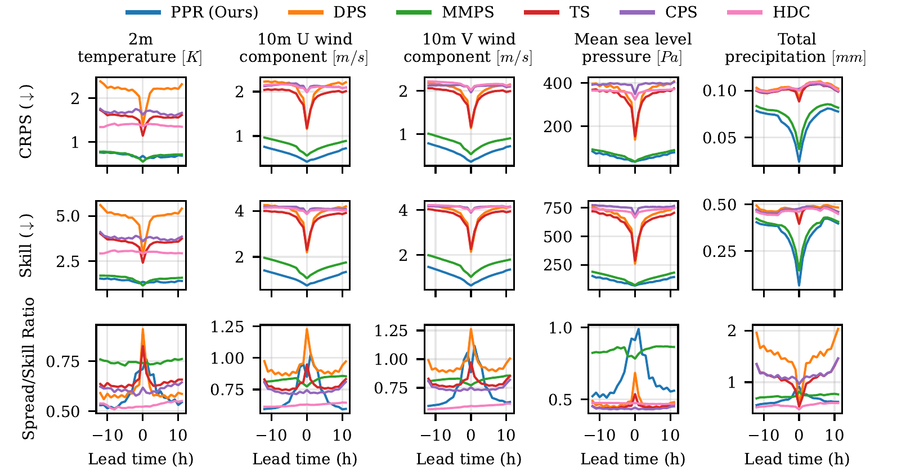
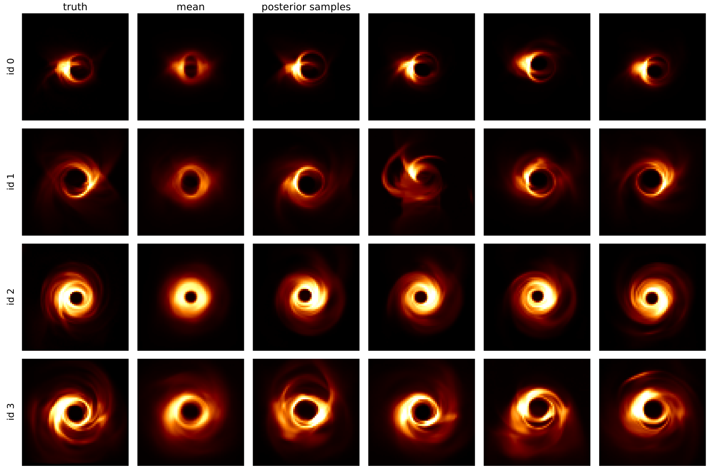

class: black-slide
background-image: url(figures/title-bg.gif)
background-size: cover

.overlay-box.overlay-title-slide[
.overlay-title[Harness, don't retrain .smaller[Diffusion models as steerable priors for inverse problems]]

.title-author[.title-author-text[Gilles Louppe .smaller[[g.louppe@uliege.be](mailto:g.louppe@uliege.be)]]]

.title-footer[.smaller[Flatiron Institute, New York October 28, 2026]]
]

???

Thank you for the invitation. It is a pleasure to be here.

This talk is about one property of diffusion models. Their sampling can be steered at inference time, without retraining. A single pretrained model then serves as the prior of many inverse problems.

We will start with a few pictures of inverse problems in science. Then we will turn to one problem, the state of the atmosphere, and follow it until the end of the talk.

---

class: middle, black-slide, center
background-image: url(figures/title-bg.gif)
background-size: cover

.bold.larger.shadowed[From a noisy observation $y$...]

???

Suppose we observe this. It is a coarse and noisy observation $y$ of a 2D turbulent flow, averaged over large blocks.

---

class: middle, black-slide, center

.bg-video[<video autoplay muted loop playsinline poster="figures/x.png" src="figures/videos/teaser-x.mp4"></video>]

.bold.larger.shadowed[... can we recover   all plausible physical states $x$?]

???

Given $y$, we want to recover all plausible physical states $x$ that could have produced it. Here is one of them, the true flow. Many others are consistent with the same blocks. We want them all, as a distribution.

This toy flow is not an exception. The same question arises whenever an instrument stands between us and the system we study. Let me show you three examples, from molecules to black holes.

---

class: black-slide
background-image: url(figures/mic-y.png)
background-size: cover

.overlay-box.overlay-intro[
.overlay-title[Cryo-electron microscopy]

Thousands of noisy 2D projections $y$ of a molecule, in unknown orientations.
]

.footnote[Simulated particle images of the .italic[P. falciparum] 80S ribosome (EMD-2660).]

???

First, structural biology. Cryo-electron microscopy images molecules frozen in ice. Each image is a 2D projection of the molecule, seen from an unknown angle, blurred by the microscope and buried in noise. The noise is unavoidable, because a stronger electron beam would destroy the sample. A typical dataset holds hundreds of thousands of such images. This is the observation $y$.

---

class: black-slide
background-image: url(figures/mic-x.png)
background-size: cover

.overlay-box.overlay-intro[
.overlay-title[Cryo-electron microscopy]

The 3D structure $x$ of the molecule.
]

.footnote[Structure: EMD-2660, [Wong et al](https://doi.org/10.7554/eLife.03080), eLife 2014. Flow-prior reconstruction: [Zhou et al](https://arxiv.org/abs/2410.08631), ICLR 2025 (arXiv:2410.08631).]

???

From all those images, we want to recover the molecule itself, in 3D. Here, a ribosome of the malaria parasite, at near-atomic resolution. That is our state $x$, and every detail of it has to be inferred from those noisy projections.

---

class: black-slide
background-image: url(figures/mri-y.png)
background-size: cover

.overlay-box.overlay-top-right[
.overlay-title[Accelerated MRI]

Undersampling k-space speeds up the scan but leaves aliased images $y$.
]

.footnote[Credits: [Rozet et al](https://arxiv.org/abs/2405.13712), NeurIPS 2024 (arXiv:2405.13712).]

???

Second, medical imaging. An MRI scan measures the image in Fourier space, line by line. To make scans faster, we measure only some of the lines, here one out of six. A naive reconstruction then gives these blurry, aliased images. This is the observation $y$.

---

class: black-slide
background-image: url(figures/mri-x.png)
background-size: cover

.overlay-box.overlay-top-right[
.overlay-title[Accelerated MRI]

The full-resolution scans $x$.
]

.footnote[Credits: [Rozet et al](https://arxiv.org/abs/2405.13712), NeurIPS 2024 (arXiv:2405.13712).]

???

What we would like to see instead is the knee itself, at full resolution. That is our state $x$. To get there, the missing lines have to be filled in, in a way that is consistent with what a knee looks like.

---

class: black-slide
background-image: url(figures/bh-y.png)
background-size: cover

.overlay-box.overlay-top-left[
.overlay-title[Black hole imaging]

A few radio telescopes across the Earth sample the Fourier transform $y$ of the image.
]

.footnote[Data: [EHT Collaboration](https://github.com/eventhorizontelescope/2019-D01-01), M87*, April 11, 2017.]

???

Third, radio astronomy. The Event Horizon Telescope combines radio telescopes all over the Earth, to image the black hole at the center of the galaxy M87. Each pair of telescopes measures one Fourier coefficient of the image. As the Earth rotates, these measurements trace these tracks. This is everything that was measured on one night in April 2017. This is the observation $y$, and most of the plane is empty.

---

class: black-slide
background-image: url(figures/bh-x.png)
background-size: cover

.overlay-box.overlay-top-left[
.overlay-title[Black hole imaging]

Images $x$ of M87*, all consistent with the data.
]

.footnote[Credits: [Wu et al](https://arxiv.org/abs/2405.18782), NeurIPS 2024 (arXiv:2405.18782).]

???

From those few measurements, we want the image of the black hole. Or rather, images, because many of them fit the same data. Here are a few, each one a possible state $x$. The ring is always there. The fine details change from one to the next.

---

class: middle

.center.width-80[]

## Inverse problems in science

Given noisy observations $y$, estimate the posterior distribution $$p(x|y) \propto p(x) p(y|x)$$ of latent states $x$.

???

All these examples are the same problem, and this diagram shows it.

A physical model describes the state $x$ of a system, a cell, a galaxy, the Earth. An observation model, the instrument, turns this state into the observation $y$, through a microscope, a telescope or a satellite. Both run forward, from causes to effects.

We want to go backward. Given $y$, which states $x$ could have produced it? There is no single answer, because the observation is noisy and incomplete. There is a distribution of answers, the posterior $p(x|y)$.

By Bayes' rule, the posterior combines two terms, one for each box. The prior $p(x)$ comes from the physical model. The likelihood $p(y|x)$ comes from the observation model.

---

class: middle

.grid[
.kol-1-4[&nbsp;]
.kol-3-4[.flow.flow-right[Generation]]
]

.grid[
.kol-1-4[&nbsp;]
.kol-3-8[.center[.icons[] .bold[Prior] $p(x)$]]
.kol-3-8[.center[.icons[] .bold[Likelihood] $p(y | x)$]]
]

.recipe[
.grid[
.kol-1-4[.italic[Cryo-EM]]
.kol-3-8[.center[3D structures of molecules]]
.kol-3-8[.center[projection, microscope blur, noise]]
]

.grid[
.kol-1-4[.italic[MRI]]
.kol-3-8[.center[full-resolution scans]]
.kol-3-8[.center[undersampled Fourier, noise]]
]
.grid[
.kol-1-4[.italic[Earth observation]]
.kol-3-8[.center[3D atmospheric states]]
.kol-3-8[.center[radiative transfer]]
]
.grid[
.kol-1-4[.italic[Black hole imaging]]
.kol-3-8[.center[images of black holes]]
.kol-3-8[.center[sparse Fourier sampling, noise]]
]
]

.grid[
.kol-1-4[&nbsp;]
.kol-3-4[.flow.flow-left[Inference]]
]

???

Here are the prior and the likelihood of each example, and of the atmosphere, to which we will come back.

The likelihood is the easy part. It is the instrument, which we usually know well, a projection, a Fourier transform, a radiative transfer model, plus noise.

The prior is the hard part. It is often already available, as a scientific simulator, an ocean model, a climate model, a simulation of black holes. But a simulator is a regular computer program. It runs forward and offers no way to run it backward, conditioned on an observation. In that form, the prior is of little help for inversion.

For a given system, the two terms do not change at the same pace. The instrument changes: a new satellite, a new resolution, a new network of stations. The physics does not. The prior should be learned once, and reused with every new likelihood.

For inference, we need a representation of the prior that we can work with. Deep generative models will give us one.

---

class: middle

## Diffusion models 101

A forward diffusion process gradually turns samples $x \sim p(x)$ into noise,
$$\text{d} x\_t = f\_t x\_t \text{d}t + g\_t \text{d}w\_t.$$

.center[
.width-90[]
.italic[Forward diffusion process.]
]

.footnote[Adapted from [Song](https://yang-song.net/blog/2021/score/), 2021.]

???

Diffusion models are the representation we will use. Trained on the outputs of a simulator, or on data, they learn to generate new samples of the system. And, as we will see, their way of generating can be steered by an observation.

A diffusion model is made of two parts. The first is a gradual noising process. The second is the reverse of it, which removes the noise.

The first part is easy. Starting from a sample of the data, we add a little noise, then a little more, until nothing but noise remains. This is described by a stochastic differential equation, where $x\_t$ is the perturbed sample at time $t$. On the left, the flow of the opening slides dissolves into noise. On the right, the same process on a simple 1D distribution, two modes that slowly merge into a single Gaussian.

---

class: middle

The reverse process is also a diffusion, driven by the .bold[score] $\nabla\_{x\_t} \log p(x\_t)$,
$$\text{d}x\_t = \left[ f\_t x\_t - g\_t^2 \nabla\_{x\_t} \log p(x\_t) \right] \text{d}t + g\_t \text{d}w\_t.$$
Simulating it from noise $x\_1$ to $t = 0$ generates samples $x\_0 \sim p(x)$.

.center[
.width-90[]
.italic[Reverse denoising process.]
]

.footnote[Adapted from [Song](https://yang-song.net/blog/2021/score/), 2021.]

???

The second part runs this process backward in time. The reverse is again a stochastic differential equation, and it involves one new quantity, the score of the noisy data at each time $t$.

And this is how we generate data. We start from pure noise, a random draw that carries no information at all. Then we run the reverse process, step by step, back to $t = 0$. The noise is gradually removed, structure appears, and a flow emerges.

This flow never existed. It is not a copy of a training example. It is a new sample, drawn from the distribution of all flows the model has learned. Every run starts from different noise, and gives a different, plausible flow.

That is exactly what we wanted from a prior. A way to draw plausible states of the system, as many as we want.

---

class: middle

.center.width-90[]

The score is unknown, but can be approximated via a neural denoiser $d\_\theta(x\_t, t)$ trained to recover $x$ from $x\_t$,
$$\min\_\theta \\, \mathbb{E}\_{p(t)p(x)p(x\_t|x)} \left[ || d\_\theta(x\_t, t) - x ||^2\_2 \right].$$
The optimal denoiser is $\mathbb{E}[x | x\_t]$, which gives the score by Tweedie's formula,
$$\nabla\_{x\_t} \log p(x\_t) = \Sigma\_t^{-1}(\mathbb{E}[x | x\_t] - x\_t) \approx \Sigma\_t^{-1}(d\_\theta(x\_t, t) - x\_t) = s\_\theta(x\_t, t).$$

???

There is one catch. The reverse process needs the score, and we do not know it.

We can approximate the score via a neural network trained to denoise. We take a sample, add noise to it at some level $t$, and ask the network to recover the clean sample. The network sees the noisy flow and the noise level, and returns its best guess of the clean flow. We repeat this for all noise levels.

The best possible denoiser returns the average of all clean samples compatible with the noisy one. And a classical result, Tweedie's formula, turns this average into the score. So a good denoiser gives us the score, and the score gives us the reverse process.

---

class: middle

$x_t$

$\xrightarrow{\;\text{denoise}\;}$

$\hat{x}$

$\xrightarrow{\;\text{renoise}\;}$

$x_s$

In practice, the reverse process is simulated in a few dozen steps, from $t = 1$ down to $t = 0$. Each step, from $t$ to the next time $s < t$, denoises the current state with the score, by Tweedie's formula,
$$\hat{x} = x\_t + \Sigma\_t \, s\_\theta(x\_t, t),$$
then renoises it to the lower noise level, by sampling the Gaussian
$$x\_s \sim p(x\_s \mid x\_t, x = \hat{x}).$$

???

In practice, we do not solve the reverse equation exactly. We discretize it into a few dozen noise levels, and each step does two things. First, it uses the score to compute the best guess $\hat{x}$ of the clean state. By Tweedie's formula, this is the output of the denoiser. We write it with the score, because the score is what we will modify. Then, it adds noise back, at a lower level, by sampling the Gaussian of the next noisy state given the current one and the guess. This Gaussian is known in closed form. For a diffusion $x\_t = x + \epsilon$, with $\epsilon \sim \mathcal{N}(0, \Sigma\_t)$, its mean is $\hat{x} + \Sigma\_s \Sigma\_t^{-1}(x\_t - \hat{x})$ and its covariance $\Sigma\_s - \Sigma\_s \Sigma\_t^{-1} \Sigma\_s$. Repeated, these two steps simulate the reverse equation of the previous slide. The images above are one such step.

That is the whole sampler. A short loop, around a network that was trained once and is never modified. The network belongs to whoever trained it. The loop is ours, and we can change it as we like. The rest of the talk is about what to put in it.

---

class: middle

## Posterior sampling: retrain...

.center.width-90[]

To sample from the posterior $p(x|\textcolor{#d62728}{y})$, one can .bold[hard-wire] the observation $\textcolor{#d62728}{y}$ as an additional input of the denoiser $d\_\theta(x\_t, t, \textcolor{#d62728}{y})$ and train it on pairs $(x, \textcolor{#d62728}{y})$.

.alert[Every new instrument requires training a new network.]

???

Back to inverse problems. We want a diffusion model that gives us samples of $x$ given $y$.

The direct approach feeds $y$ to the denoiser as an extra input, here the coarse observation of the opening slide, and trains it on pairs of $x$ and $y$. This works, but the network is then tied to one instrument. Change the instrument, its resolution or its noise, and the network must be trained again.

---

class: middle

## ... or harness.

.center.width-10[]

Instead, we keep the pretrained model and .bold[harness] its sampling. Since
$$\nabla\_{x\_t} \log p(x\_t | \textcolor{#d62728}{y}) = \nabla\_{x\_t} \log p(x\_t) + \nabla\_{x\_t} \log p(\textcolor{#d62728}{y} | x\_t),$$
it suffices to add the likelihood score to the prior score in the denoising step,
$$\hat{x} = x\_t + \Sigma\_t \big( \underbrace{s\_\theta(x\_t, t)}\_{\text{pretrained prior}} + \underbrace{\textcolor{#d62728}{\nabla\_{x\_t} \log p(y | x\_t)}}\_{\text{likelihood}} \big),$$
and to renoise as before. The loop then produces posterior samples $x \sim p(x | \textcolor{#d62728}{y})$, and the network is never retrained.

???

There is a better way, and it is the main idea of this talk. We do not retrain anything. We harness the pretrained model instead.

By Bayes' rule, the score of the posterior is the score of the prior plus the score of the likelihood. The prior score comes from the pretrained diffusion model. The likelihood score comes from the model of the instrument.

So we go back to the sampling step of a few slides ago and change one term. In the denoising step, we add the likelihood score to the prior score. The renoising step does not change. The loop now produces posterior samples. Equivalently, the reverse equation is driven by the score of the posterior instead of the score of the prior.

The network is untouched. Change the instrument, and only the red term changes. The same prior serves any instrument, zero-shot. Few generative models can be conditioned this simply. Diffusion models can.

There is one catch. The likelihood score of a noisy state is intractable.

---

class: middle

.avatars[]

## The likelihood score

The likelihood of a noisy state,
$$p(y | x\_t) = \int p(y | x) p(x | x\_t) \text{d}x,$$
is intractable.

MMPS approximates $p(x | x\_t)$ by a Gaussian, with Tweedie's covariance,
$$p(x | x\_t) \approx \mathcal{N}\big(x \mid \mathbb{E}[x | x\_t], \mathbb{V}[x | x\_t]\big), \quad \mathbb{V}[x | x\_t] = \Sigma\_t \nabla\_{x\_t} \mathbb{E}[x | x\_t].$$
For $p(y | x) = \mathcal{N}(y | Ax, \Sigma\_y)$,
$$\textcolor{#d62728}{\nabla\_{x\_t} \log p(y | x\_t)} \approx \nabla\_{x\_t} \mathbb{E}[x | x\_t]^\top A^\top \big(\Sigma\_y + A \mathbb{V}[x | x\_t] A^\top\big)^{-1} \big(y - A \mathbb{E}[x | x\_t]\big).$$

.footnote[Credits: [Rozet et al](https://arxiv.org/abs/2405.13712), NeurIPS 2024 (arXiv:2405.13712). DPS: [Chung et al](https://arxiv.org/abs/2209.14687), ICLR 2023.]

???

The likelihood of a noisy state averages the likelihood of the clean state over all clean states compatible with the noisy one. This integral is intractable.

The simplest approximation, DPS, replaces this distribution by a single point, the output of the denoiser. At high noise, this point is a poor summary. Many clean states are compatible with the noisy one, and DPS keeps only their average.

Our approximation, MMPS, keeps the uncertainty. It replaces the distribution by a Gaussian. The mean is the output of the denoiser. The covariance is given by the second-order Tweedie formula, the Jacobian of the denoiser. For a Gaussian instrument, the likelihood of the noisy state is then Gaussian too, and its score has this closed form.

The covariance has as many entries as the state squared, and we never build it. We only need its products with vectors, which automatic differentiation gives for the cost of a backward pass. A few iterations of conjugate gradient solve the system.

This assumes a Gaussian likelihood and a linear instrument, or one we can linearize. We will come back to this assumption at the end of the talk.

---

class: black-slide
background-image: url(figures/satellite-crop.gif)
background-size: cover

.overlay-box.overlay-bottom-left[
.overlay-title[Earth observation]

Satellites measure radiances $y$, not the state of the atmosphere.
]

.footnote[Animation: [ESA/ATG medialab](https://www.esa.int/ESA_Multimedia), Sentinel-1.]

???

We now turn to one problem, the state of the atmosphere, and follow it until the end of the talk. Every day, satellites and weather stations deliver millions of observations. They are sparse, noisy and indirect, and they keep arriving over time. This is $y$.

Satellites do not measure the state of the atmosphere. They measure radiances. To go from the state to the radiances, we need a radiative transfer model, a simulator in its own right. Keep it in mind. We will need it at the end.

---

class: black-slide
background-image: url(figures/da-x.png)
background-size: cover

.overlay-box.overlay-bottom-right[
.overlay-title[Earth observation]

The state $x$ of the atmosphere, here the wind speed at 10 m.
]

.footnote[Data: [ERA5](https://doi.org/10.1002/qj.3803) reanalysis, 10 m wind speed, March 21, 2021.]

???

From all these observations, we want to reconstruct the atmosphere itself, in 3D and over time, as a trajectory. Here you see one moment of it, through the surface wind. Estimating it from observations is data assimilation. It produces the reanalyses that climate science relies on, and the starting point of every weather forecast.

---

class: middle

## Data assimilation

We estimate trajectories $x\_{1:L}$ given observations $y\_{1:L}$, as the posterior
$$p(x\_{1:L} | y\_{1:L}) \propto p(x\_1) p(y\_1 | x\_1) \prod\_{i=2}^{L} p(x\_{i} | x\_{i-1}) p(y\_{i} | x\_{i}).$$

.center.width-100[]

???

Formally, the atmosphere evolves from one state to the next, following a transition model, and each state is observed through an observation model. Data assimilation is the posterior over whole trajectories, given all observations.

This problem is as old as numerical weather prediction. The methods used operationally today, such as 4D-Var and ensemble Kalman filters, rely on Gaussian or linear assumptions about the dynamics.

We want to replace them with a diffusion prior over trajectories, which makes no such assumption, and steer it with the observations, as in the recipe. Three obstacles stand in the way. The trajectories are much longer than anything we can train on. They have billions of variables. And the physics and the instruments ask for more than the Gaussian likelihood we have assumed so far. We take them in this order.

---

class: middle

.avatars[]

.center.width-80[]

SDA trains a diffusion model on short windows only. For Markovian dynamics, the score of a long trajectory is assembled from them,
$$\nabla\_{x\_i} \log p(x\_{1:L}) = \nabla\_{x\_i} \log p(x\_{i-k:i+k}),$$
and the posterior of the whole trajectory is sampled by adding the likelihood score of all observations,
$$\nabla \log p(x\_{1:L}(t) | y) = \nabla \log p(x\_{1:L}(t)) + \textcolor{#d62728}{\nabla \log p(y | x\_{1:L}(t))}.$$

.footnote[Credits: [Rozet and Louppe](https://arxiv.org/abs/2306.10574), NeurIPS 2023 (arXiv:2306.10574).]

???

The first step is our score-based data assimilation, SDA. It does two things at once. First, we train a diffusion model on short windows of a trajectory only. Because the dynamics are Markovian, each state only interacts with its close neighbors in time. So the score of a long trajectory can be assembled from the scores of short windows, all computed in parallel. This is exact for clean trajectories, and approximate for noisy ones. Second, we sample the posterior of the whole trajectory, given all observations at once. This is the sampling step we already know. In the denoising step, the prior score of the trajectory comes from the windows, and we add the likelihood score of the observations, approximated as before. The trajectories we sample are posterior trajectories, and nothing is retrained.

---

class: middle

.avatars[]

.center.width-100[]

.center[Ground truth $x\_{1:L}$ and coarse, noisy, sparse observations $y$.]

.footnote[Credits: [Rozet and Louppe](https://arxiv.org/abs/2306.10574), NeurIPS 2023 (arXiv:2306.10574).]

???

A toy example, a 2D turbulent flow. The top row is the true trajectory. The second row shows what we observe, coarse, noisy, and only every few time steps.

---

class: middle
count: false

.avatars[]

.center.width-100[]

.center[Posterior samples of the trajectory, given $y$.]

.footnote[Credits: [Rozet and Louppe](https://arxiv.org/abs/2306.10574), NeurIPS 2023 (arXiv:2306.10574).]

???

And these are posterior samples. They are consistent with the observations, and they differ where the observations leave room.

---

class: middle

.avatars[]

## Long trajectories

SDA composes short windows all at once (AAO). At high noise, its score decomposition is only approximate, and observations stay local.

.center.width-100[]

.grid[
.kol-1-3[.center.smaller[Ignores future observations.]]
.kol-1-3[.center.smaller[Approximate at high noise.]]
.kol-1-3[.center.smaller[Converges to $p(x\_{1:L} | y)$.]]
]

.footnote[Credits: Bodart, Andry, Rozet and Louppe, under review at ICLR 2027.]

???

For long trajectories, such as a whole season, we cannot train a model over the whole horizon. We must compose short windows at sampling time, and how we compose them matters.

Rolling out one window after the other ignores future observations, and errors accumulate. Composing all windows at once, as SDA does, has a subtler problem. Its decomposition of the score is only approximate at high noise. Each window only sees its neighbors, so the information brought by an observation at one time step does not travel far enough. It fails to reach states far in the past or far in the future, where it should still matter.

Our new solution, GiBBS, goes back to an old idea, Gibbs sampling. It repeatedly redraws blocks of states $x\_{i:j}$ from their exact conditionals $p(x\_{i:j} | x\_{i-k:i-1}, x\_{j+1:j+k}, y)$, given their neighbors and the observations. Each block is redrawn by the same sampling loop as before, a full reverse diffusion, conditioned on the few states at its borders and on the observations it contains. All blocks of the same color are redrawn in parallel, and the blocks shift from one cycle to the next. Over the cycles, the information of each observation propagates along the whole trajectory, and the chain converges to the true posterior.

---

class: middle

.avatars[]

.center.width-100[]

.center[Posterior samples of the trajectory, given $y$.]

.footnote[Credits: Bodart, Andry, Rozet and Louppe, under review at ICLR 2027.]

???

As an example, we go back to the turbulent flow, with observations that only cover the middle of the trajectory. GiBBS keeps the vortices coherent all along. The all-at-once composition smooths them out, and the rollout drifts away.

So far, every state was a small 2D flow, a few thousand numbers. With SDA and GiBBS, we can now handle long trajectories of them. But the real atmosphere is not a small 2D flow.

---

class: black-slide
background-image: url(figures/earth-bg.png)
background-size: cover

.overlay-box.overlay-bottom-right[
.overlay-title[$O(10^{10})$ variables]

At 0.25°, 6 variables on 13 pressure levels, hourly over two weeks, a trajectory $x\_{1:L}$ has $721 \times 1440 \times 6 \times 13 \times 24 \times 14 \approx 27 \times 10^9$ variables.
]

???

At the resolution of modern weather models, a two-week trajectory of the atmosphere has about 27 billion variables. That is far beyond what a diffusion model can handle directly.

---

class: middle

.avatars[]

## Latent diffusion

.center.width-95[]

.grid[
.kol-3-4[
.center[
<video poster="figures/videos/lola_euler_poster.jpg" controls="" muted="" loop="" width="100%" autoplay>
        <source src="figures/videos/lola_euler.mp4" type="video/mp4">
</video>
]
]
.kol-1-4[  LDMs trained on compressed latent states $z = E(x)$ remain accurate even at high compression rates.]
]

.footnote[Credits: [Rozet et al](https://arxiv.org/abs/2507.02608), NeurIPS 2025 (arXiv:2507.02608).]

???

So we compress. A latent diffusion model learns the prior in a compressed space, much smaller than the original one, and decodes its samples back. Our work on LoLA showed that this works well for physics, even at high compression. This was a surprise. Physics is defined in the original space, through equations on the full fields, and we expected compression to break it. It does not. The latent space retains what matters for the dynamics. This work started here, at Flatiron, with François Lanusse, Ruben Ohana, Michael McCabe and Shirley Ho.

---

class: middle

.avatars[]

## Appa

.center.width-80[]

An autoencoder compresses each atmospheric state $x$ 450 times into a latent state $z = E(x)$. A latent diffusion model generates trajectories $z\_{1:L}$, decoded as $x\_{1:L} = D(z\_{1:L})$. Posterior sampling runs in latent space.

.footnote[Credits: [Andry et al](https://arxiv.org/abs/2504.18720), NeurIPS ML4PS workshop 2025 (arXiv:2504.18720).]

???

Based on this idea, we built Appa, for the global atmosphere. An autoencoder compresses each state 450 times. A latent diffusion model, with a billion parameters, generates trajectories in that compressed space. Data assimilation then happens in latent space, at the scale of the whole Earth.

---

class: middle

.avatars[]

## Posterior sampling in latent space

The observations constrain the decoded state, so the likelihood of a latent state is
$$p(y | z) = \mathcal{N}\big(y \mid \mathcal{A}(D(z)), \Sigma\_y\big).$$
At each step, the observation operator and the decoder are linearized together, around the denoiser's estimate $\hat{z} = \mathbb{E}[z | z\_t]$,
$$\mathcal{A}(D(z)) \approx \mathcal{A}(D(\hat{z})) + J (z - \hat{z}), \quad J = \nabla\_z \mathcal{A}(D(z)) \big|\_{z = \hat{z}}.$$
MMPS then applies, with $J$ in place of $A$,
$$\textcolor{#d62728}{\nabla\_{z\_t} \log p(y | z\_t)} \approx \nabla\_{z\_t} \mathbb{E}[z | z\_t]^\top J^\top \big(\Sigma\_y + J \mathbb{V}[z | z\_t] J^\top\big)^{-1} \big(y - \mathcal{A}(D(\hat{z}))\big).$$

.footnote[Credits: [Andry et al](https://arxiv.org/abs/2504.18720), NeurIPS ML4PS workshop 2025 (arXiv:2504.18720).]

???

Posterior sampling runs in latent space, but the observations are of the atmosphere, not of the latent state. The observation model therefore includes the decoder. The likelihood of a latent state is Gaussian around the decoded, then observed, state.

This model is not linear, even when the instrument is, because the decoder is a deep network. So, at each step, we linearize the observation operator and the decoder together, around the current estimate of the clean latent state, given by the denoiser. The Jacobian of the composition plays the role of the matrix $A$ of MMPS, and the likelihood score follows as before.

The Jacobian is never formed. Conjugate gradient only needs its products with vectors, which automatic differentiation gives through the decoder.

A new observation network requires no retraining. Only the operator changes.

---

class: middle

.avatars[]

.center[
<video poster="figures/videos/appa_reanalysis_poster.jpg" controls="" muted="" loop="" width="70%" autoplay>
<source src="figures/videos/appa_reanalysis_1week.mp4" type="video/mp4">
</video>
]

.footnote[Credits: [Andry et al](https://arxiv.org/abs/2504.18720), NeurIPS ML4PS workshop 2025 (arXiv:2504.18720).]

???

What Appa produces are, in effect, videos of the atmosphere. Each frame is the state of the whole planet at one hour, and the video is generated so that it agrees with everything we observed along the way.

Here is one week. Rows 1 and 4 are the truth. Rows 2 and 5 are the observations, satellite tracks and weather stations, sparse and scattered. Rows 3 and 6 are Appa's videos, filled in everywhere, and consistent with those observations.

This is a reanalysis, the first task we ask of this prior. It will not be the last.

---
class: middle

## Beyond Gaussian observation models

<b>Exact constraints</b>

$$c(x) = 0$$

conservation laws, boundary conditions

<b>Simulators</b>

$$y = \mathcal{A}(x, \eta)$$

no likelihood, no gradients

???

So far, the observations were noisy, with a Gaussian likelihood around a differentiable function of the state. Two cases break this assumption, and both are common in science.

First, the physics imposes constraints that must hold exactly: conservation of mass and energy, a divergence-free velocity, boundary conditions. A learned prior satisfies them only approximately.

Second, real instruments are simulators. Remember the satellites: they measure radiances, and the radiative transfer model that produces them is a simulator. Its likelihood is intractable, and its gradients are often unavailable.

---

class: middle

.avatars[]

## Predict-Project-Renoise: Sampling under Hard Constraints

.center[
<video poster="figures/steer/ppr_poster.jpg" muted loop autoplay playsinline width="90%">
<source src="figures/steer/ppr.mp4" type="video/mp4">
</video>
]

PPR denoises, projects through the denoiser onto $\mathcal{C} = \\{x : c(x) = 0\\}$, then renoises, several times per noise level. It targets the prior restricted to $\mathcal{C}$.

.footnote[Credits: [Rochman-Sharabi and Louppe](https://arxiv.org/abs/2601.21033), NeurIPS 2026 (arXiv:2601.21033). Toy: Gaussian mixture prior, constrained to a circle.]

???

A hard constraint is the limit of a likelihood whose noise goes to zero. In that limit, guidance breaks down: the likelihood score is informative only in the immediate vicinity of the constraint, and unstable there. Projections satisfy the constraint, but they ignore the prior, leave the data manifold and collapse the modes.

PPR starts from the target itself, the constrained marginal at each noise level. A kernel that draws a feasible clean state given the noisy one, then renoises it, leaves this marginal invariant. PPR approximates the first step by a projection through the denoiser: we optimize the noisy state so that its denoised version satisfies the constraint. Because the denoiser only outputs plausible states, the result stays on the data manifold. Then we renoise, and repeat.

Here is a toy. The prior is a mixture of five Gaussians, in grey. The constraint is the red circle. Watch the three steps: denoise, project in red, renoise. The samples end on the circle, spread over the modes where the prior puts its mass.

---

class: middle

.avatars[]

.center.width-90[]

.center[Appa under a hard constraint through its decoder, at noon. PPR (blue) improves over all baselines.]
.footnote[Credits: [Rochman-Sharabi and Louppe](https://arxiv.org/abs/2601.21033), NeurIPS 2026 (arXiv:2601.21033).]

???

The same Appa prior, a second task. We constrain the decoded state at noon to match a given atmospheric state exactly, through the 170-million-parameter decoder. Each state has about $10^8$ variables.

The figure shows three scores, against the lead time around noon, for five surface variables. Lower is better for the first two rows. PPR, in blue, is the best everywhere.

This experiment uses an exact observation as the constraint. Enforcing the physics itself, such as conservation laws, at this scale, is still open.

On the Kuramoto-Sivashinsky equation, more than 82% of PPR samples are feasible, against at most 1% for the baselines.

---

class: middle

.avatars[]

## Kalman Posterior Sampling with Diffusion Priors and Simulation‑Based Likelihoods

.center[
<video poster="figures/steer/kps_poster.jpg" muted loop autoplay playsinline width="90%">
<source src="figures/steer/kps.mp4" type="video/mp4">
</video>
]

KPS denoises, simulates $y^{(i)} = \mathcal{A}(x^{(i)}, \eta^{(i)})$, corrects each particle with a Kalman update, then renoises. No likelihood is needed.

.footnote[Credits: Andry, Savary, Rozet and Louppe, under review at ICLR 2027. Toy: same prior, noisy observation of the radius.]

???

This is ongoing work. When the instrument is a simulator, we cannot evaluate the likelihood, and we may not have its gradients. We can only run it.

KPS works with an ensemble of particles. At each noise level, each particle is denoised into a draw of the clean state. We run the simulator on it. From these simulated pairs, we fit a linear Gaussian model of the instrument, a statistical linearization, and we move each particle with a Kalman update toward the observation. Then we renoise, as in PPR, and repeat. The structure is the same: denoise, correct, renoise. Only the correction changes.

The toy uses the same prior as before, and observes the radius with noise. The samples fill the red band, where the prior puts its mass.

---

class: middle

.avatars[]

.center.width-80[]

.center[Black-hole imaging from interferometric visibilities. Truth, posterior mean and four KPS samples (16 particles), for four test images.]
.footnote[Credits: Andry, Savary, Rozet and Louppe, under review at ICLR 2027.]

???

Back to the black holes of the beginning. The forward model is the interferometer: it is non-linear, and its noise is not Gaussian in image space.

These are four test images of the InverseBench benchmark. For each, the truth, the posterior mean, and four posterior samples, from an ensemble of only 16 particles. The samples agree on what the data determine, the ring and its size, and differ on what they do not, the fine structure of the emission. On some instances, they differ markedly. In the paper, we check that such distinct images fit the visibilities about as well as the truth.

On InverseBench, KPS with only 16 particles exceeds the best published accuracy on the two tasks where gradients are affordable, and is close to calibrated on black-hole imaging. Next, we want to use it with satellite radiances in Appa.

---

class: middle

## Conclusions

One pretrained prior, steered at inference time, never retrained:

.grid[
.kol-1-4[.center[.bold[Scores] .smaller[MMPS keeps the uncertainty of the denoiser in the likelihood score.]]]
.kol-1-4[.center[.bold[Time] .smaller[SDA and GiBBS compose short windows into long trajectories.]]]
.kol-1-4[.center[.bold[Constraints] .smaller[PPR projects through the denoiser, then renoises.]]]
.kol-1-4[.center[.bold[Simulators] .smaller[KPS replaces the likelihood score by a Kalman update.]]]
]

.challenge[
- Can physical constraints be enforced at the scale of the atmosphere?
- Can we trust a posterior when there is no ground truth to compare with?
- How far does a Gaussian correction go for strongly non-linear simulators?
- Can we sample $10^{10}$ variables as fast as the weather changes?
]

???

We started from a pretrained prior and a sampling loop of two steps, denoise and renoise. Every method of this talk changes one part of this loop, and none retrains the network.

MMPS gives a better likelihood score, by keeping the uncertainty of the denoiser. SDA and GiBBS compose short windows into long trajectories, and GiBBS converges to the posterior. PPR enforces hard constraints, by projecting through the denoiser and renoising. KPS handles instruments that are simulators, with a Kalman update estimated from simulations.

PPR, KPS and GiBBS share one structure. They correct, they renoise, and they repeat. This is Gibbs sampling, at a fixed noise level or across time.

For the atmosphere, one prior, Appa, now serves several tasks: reanalysis from sparse observations, sampling under hard constraints and, next, satellite radiances.

Four questions remain open. Can we enforce the physics itself, such as conservation laws, at the scale of the atmosphere? Can we trust the posteriors? In science, we rarely know the true state, so we need ways to check that the uncertainty we report is the right one. How far does a Gaussian correction go when the simulator is strongly non-linear? And can we go fast enough? Weather centers assimilate hundreds of millions of observations every few hours. Our methods are not there yet. Behind all of these lies one more question: what happens when the prior itself, learned from imperfect simulations, is wrong?

---

class: black-slide
background-image: url(figures/closing.png)
background-size: cover

.overlay-box.overlay-center.overlay-equation[
$$p(x | y) \propto p(x) \, p(y | x)$$
]

???

I will leave you with the equation we started from.

Molecules, knees, black holes, the whole atmosphere. Very different problems, but always the same recipe. A prior for the physics, learned once by a diffusion model. A likelihood for the instrument, which changes from one problem to the next. And a sampling loop that combines them, which we can steer without retraining anything.

Thank you.

---

count: false

.center.width-10[]

.center[

.width-13.circle[] 
.width-13.circle[] 
.width-13.circle[] 
.width-13.circle[] 
.width-13.circle[]

.width-13.circle[] 
.width-13.circle[] 
.width-13.circle[] 
.width-13.circle[]

.width-13.circle[] 
.width-13.circle[] 
.width-13.circle[] 
.width-13.circle[]

.smaller[François Rozet, Gérôme Andry, Fanny Bodart, Thomas Savary, Omer Rochman, Victor Mangeleer, Elise Faulx, Sacha Lewin, Matthias Pirlet, François Lanusse, Ruben Ohana, Michael McCabe, Shirley Ho]

]

---

class: middle, center, end-slide
count: false

The end.
